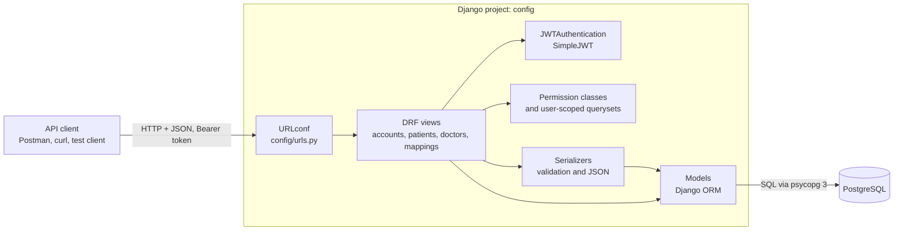
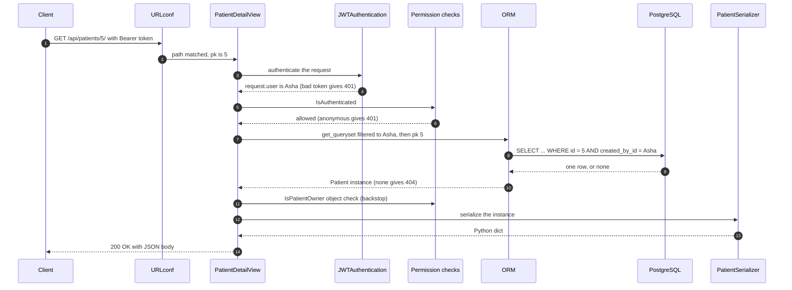
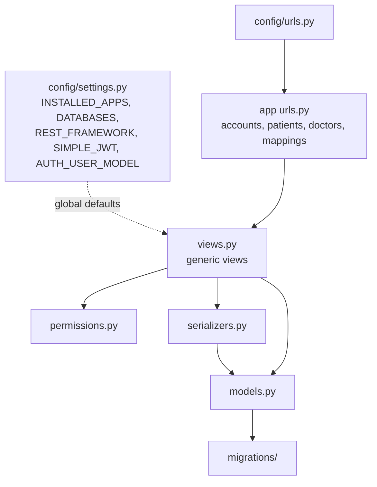
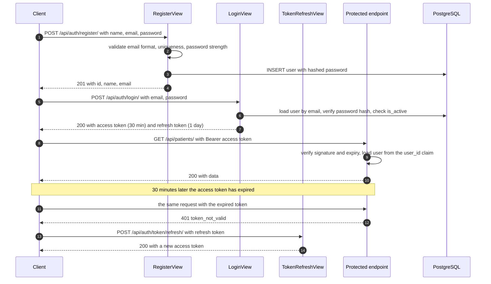
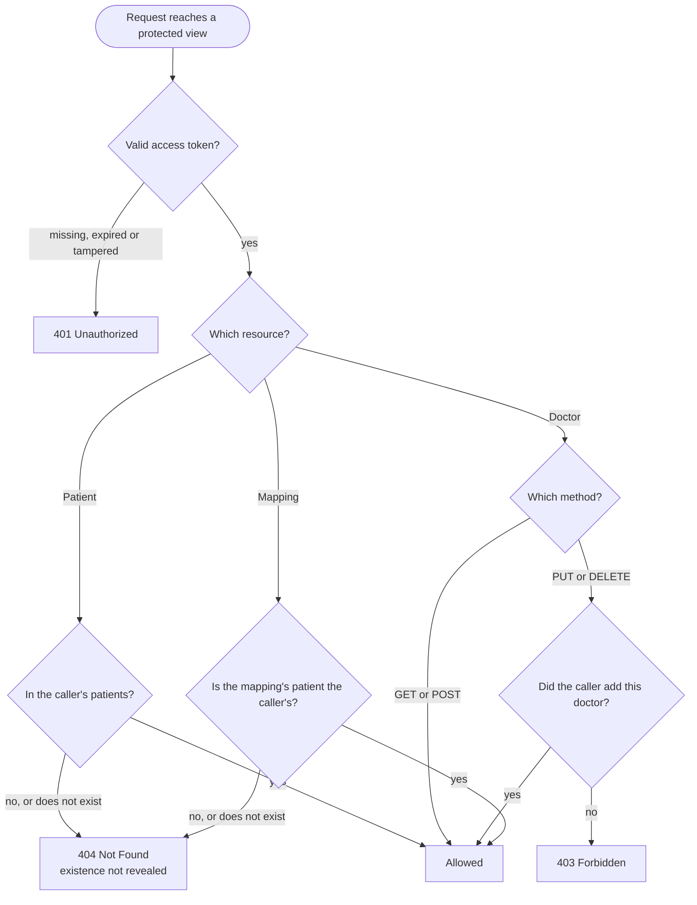
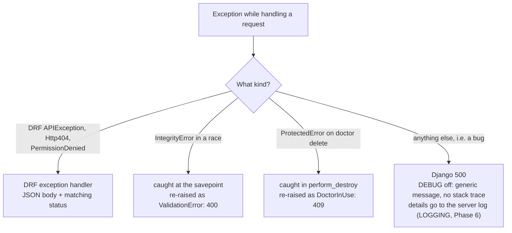
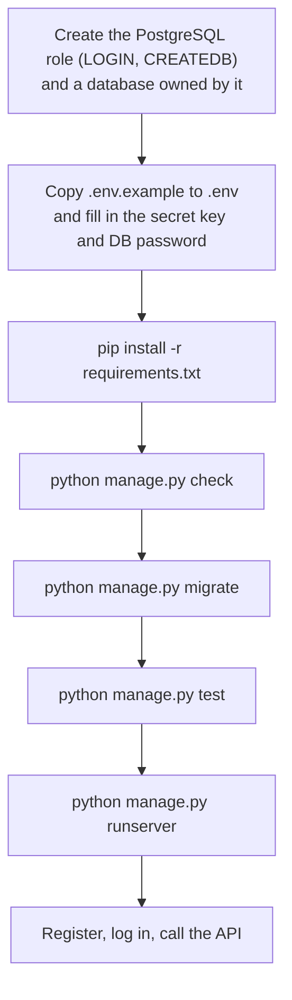
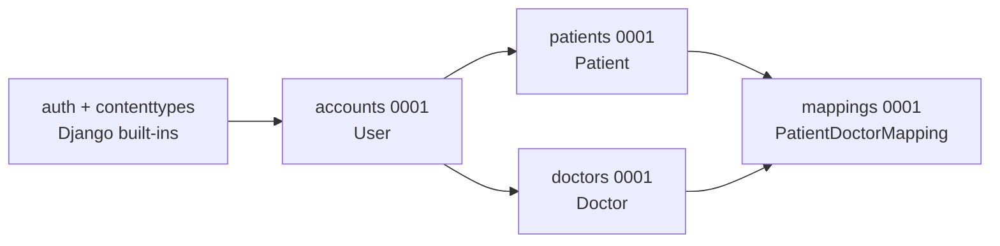

# Architecture — Healthcare Backend

**Status:** Approved 27 Oct 2026. Phase 2 (project configuration) is implemented. The rest describes Phases 3–9 and is updated as each phase lands.
**Related:** [design.md](design.md) (data and API contracts) · [class.md](class.md) (class reference)

**Assignment requirement or our design?** The assignment mandates the stack: Django, DRF, PostgreSQL, the Django ORM, SimpleJWT and environment variables for sensitive configuration. Everything else in this document is our design.

---

## 1. Overview

There is one Django project (`config`) with four domain apps. DRF turns Django into a JSON API, SimpleJWT issues and checks tokens, and the ORM talks to PostgreSQL through psycopg 3. No other services are involved.



| Layer | Technology | Its job in this project |
|---|---|---|
| HTTP and routing | Django 5.2.18 (LTS) | Receives the request and matches the URL to a view |
| API framework | Django REST Framework 3.18.3 | Parses JSON, runs authentication and permissions, calls the serializer, returns JSON with the right status code |
| Tokens | SimpleJWT 5.5.1 (PyJWT 2.15.1 underneath) | Issues access and refresh tokens at login; verifies the Bearer token on every protected request |
| Validation and representation | DRF serializers | Check input; convert between JSON and model instances |
| Data access | Django ORM + psycopg 3.3.6 | Builds SQL from Python (e.g. `Patient.objects.filter(...)`); generates and runs migrations |
| Storage | PostgreSQL 14+ (verified on 16.15) | Stores the rows; enforces foreign keys and unique constraints |
| Configuration | python-dotenv 1.2.4 + `os.environ` | Loads secrets and settings from `.env` into `settings.py` |

The exact pins are in `requirements.txt`. DRF is 3.18.3 because every release before 3.18.2 has known security advisories, and 3.18.3 also reverts an accidental API change made in 3.18.2.

## 2. Request lifecycle

Example: an authenticated user fetches one of their own patients with `GET /api/patients/5/`.



| Stage | What happens | Why it exists |
|---|---|---|
| 1. URL router | `config/urls.py` sends `api/patients/...` to `patients/urls.py`, which matches the `<int:pk>/` pattern and picks the view. A non-integer id never matches, so it gets 404. | Keeps each app's URLs next to its code |
| 2. Authentication | `JWTAuthentication` reads `Authorization: Bearer <token>`, checks the signature and expiry, and loads the user | Answers "who is calling?" |
| 3. Permissions | `IsAuthenticated` (the global default) rejects anonymous calls. Object-level checks run when a single object is fetched. | Answers "may they use this endpoint, or touch this object?" |
| 4. View | The generic view coordinates the work: it chooses the queryset, the serializer and the status code | Keeps HTTP concerns in one place |
| 5. Serializer | Input: validates fields and produces clean data. Output: turns model instances into JSON-ready dicts. | One home for validation rules and response shape |
| 6. ORM | Translates Python queries into SQL. The queryset is already filtered to the caller's rows. | No raw SQL, and ownership is part of the query itself |
| 7. PostgreSQL | Runs the SQL; enforces foreign keys and unique constraints | The last line of defence for data integrity |
| 8. Response | DRF renders JSON with the status code. Exceptions raised anywhere above become JSON error bodies. | A consistent API for clients |

## 3. How the pieces connect



- **Settings** decide which apps are loaded, which database to use, and the DRF defaults every view inherits: JWT authentication, `IsAuthenticated`, and a JSON-only parser.
- **URLs** map paths to views and do nothing else.
- **Views** choose the queryset (scoped to the user), the serializer, and any extra permission classes.
- **Serializers** own validation and the JSON shape; they create and update model instances.
- **Models** define tables, relationships and database constraints. Migrations are generated from them.
- **Permissions** hold reusable "may this user do this?" rules.

## 4. Folder structure (target)

```
healthcare-backend/
├── manage.py
├── requirements.txt
├── .env.example            # committed template, no real secrets
├── .env                    # local only, git-ignored
├── .venv/                  # local virtual environment, git-ignored
├── .gitignore
├── README.md
├── config/                 # the project package
│   ├── settings.py
│   ├── urls.py
│   ├── asgi.py
│   └── wsgi.py
├── accounts/               # users, register, login
│   ├── managers.py
│   ├── models.py
│   ├── serializers.py
│   ├── views.py
│   ├── urls.py
│   ├── tests.py
│   └── migrations/
├── patients/               # same layout + permissions.py
├── doctors/                # same layout + permissions.py
├── mappings/               # same layout
├── postman/
│   └── healthcare-backend.postman_collection.json
└── docs/
    ├── architecture.md, design.md, class.md   # committed
    ├── plan.md, memory.md        # committed during development
    └── learning.md, rules.md     # local only, git-ignored
```

Each app also has the `__init__.py`, `apps.py` and `admin.py` files that `startapp` creates.

## 5. Module responsibilities

| Module | Responsibility | Phase |
|---|---|---|
| `manage.py` | Command-line entry point: `runserver`, `migrate`, `test`, `createsuperuser` | 2 ✅ |
| `config/settings.py` | All configuration, read from environment variables through three small helpers (`env_required`, `env_bool`, `env_list`) | 2 ✅ |
| `config/urls.py` | Mounts `api/auth/`, `api/patients/`, `api/doctors/`, `api/mappings/` (and `admin/`) | 2–5 |
| `config/wsgi.py`, `config/asgi.py` | Server entry points (unchanged defaults) | 2 ✅ |
| `accounts/models.py` | `User`: email login, a `name` field, no username | 3 |
| `accounts/managers.py` | `UserManager`: creates users and superusers, normalises the email, hashes the password | 3 |
| `accounts/serializers.py` | `RegisterSerializer`, `EmailTokenObtainPairSerializer` | 3 |
| `accounts/views.py` | `RegisterView`, `LoginView` | 3 |
| `patients/models.py` | `Patient`, with the `created_by` owner foreign key | 4 |
| `patients/serializers.py` | `PatientSerializer`: field validation (date of birth, phone, gender) | 4 |
| `patients/permissions.py` | `IsPatientOwner`: object-level backstop | 4 |
| `patients/views.py` | List/create and detail views, with querysets scoped to the caller | 4 |
| `doctors/models.py` | `Doctor`, with a nullable `created_by` | 4 |
| `doctors/serializers.py` | `DoctorSerializer`: case-insensitive unique email | 4 |
| `doctors/permissions.py` | `IsCreatorOrReadOnly` | 4 |
| `doctors/views.py` | List/create and detail views; `DoctorInUse` (409) | 4–5 |
| `mappings/models.py` | `PatientDoctorMapping`, unique per (patient, doctor) | 5 |
| `mappings/serializers.py` | `PatientDoctorMappingSerializer`: `patient` field limited to the caller's patients | 5 |
| `mappings/views.py` | `MappingListCreateView`, `MappingDetailView` | 5 |
| `*/tests.py` | API tests for that app | 3–7 |
| `*/migrations/` | Generated schema changes, committed to Git | 3–5 |
| `postman/healthcare-backend.postman_collection.json` | Postman collection for manual and automated (newman) runs | 7 |

## 6. Database interaction and transaction boundaries

**Rule:** all database access goes through the ORM (no raw SQL), and every query that touches patient data includes the ownership filter.

| Endpoint | Query, conceptually | Queries |
|---|---|---|
| `GET /api/patients/` | `Patient.objects.filter(created_by=user)` | 1 |
| `GET /api/patients/<id>/` | the same filter, then `.get(pk=id)`; 404 if nothing matches | 1 |
| `GET /api/doctors/` | `Doctor.objects.all()` | 1 |
| `POST /api/mappings/` | find the patient inside the caller's patients, find the doctor, check for a duplicate, insert | about 4 |
| `GET /api/mappings/` | `PatientDoctorMapping.objects.filter(patient__created_by=user).select_related("patient", "doctor")` | 1 (a JOIN, so no N+1) |
| `GET /api/mappings/<patient_id>/` | the scoped patient lookup, then that patient's mappings with `select_related("doctor")` | 2 |
| `DELETE /api/mappings/<id>/` | `filter(patient__created_by=user).get(pk=id)`, then delete | 2 |

**Transactions**

- Django's default is **autocommit**: each statement commits on its own. Every endpoint here does one logical write, so wrapping every request in a transaction (`ATOMIC_REQUESTS = True`) would add cost without benefit. It is not used.
- Deletes are already atomic: `Model.delete()` collects the related rows and deletes them inside one transaction. With `PROTECT`, the check happens *before* anything is deleted, so a refused doctor delete changes nothing.
- Two writes can hit a unique constraint in a race: two registrations with the same email, or two identical mapping requests sent at the same moment. Those saves run inside `transaction.atomic()` (a savepoint), so the `IntegrityError` can be caught and returned as a clean 400 without leaving the database connection in a broken transaction.

**Indexes:** PostgreSQL gets an index for every foreign key (Django's default) and for every unique field or constraint: `accounts_user.email`, `doctors_doctor.email`, and (`patient_id`, `doctor_id`). That covers every lookup in the table above.

## 7. Authentication flow



Key facts:

- Tokens are **stateless**: the server stores nothing per token. The signature (HS256 with `SECRET_KEY`) proves the token wasn't forged, and the `exp` claim limits its lifetime.
- The token carries the user's id, not their permissions. Every request loads the user and applies the current rules, so a permission change takes effect immediately.
- Changing `SECRET_KEY` invalidates every token ever issued.
- There is no logout endpoint. A token stays valid until it expires; this is a documented limitation.
- Login uses Django's `authenticate()`. It runs the password hasher even when the email doesn't exist, which reduces the timing difference an attacker could use to discover registered emails.

## 8. Authorization flow



Creating a mapping for another user's patient is the one exception: it gets a 400 rather than a 404, because the patient id is in the request body rather than the URL.

**Why 404 for patients but 403 for doctors?** Another user's patients are invisible to you; they aren't in your queryset at all. So the honest answer is "not found", and it reveals nothing. Doctors are visible to everyone, so "you can see it, but you may not change it" is a 403.

**Security checklist** (ticked in Phase 6, with the evidence):

- [x] Every patient and mapping query is filtered by `request.user` (the views' `get_queryset()` and lookups; `PatientIsolationTests`, `MappingListTests`, `MappingByPatientTests`, `MappingDeleteTests`)
- [x] `created_by` can never be written through the API (it isn't a serializer field; `test_owner_and_id_in_the_body_are_ignored`, `test_creator_and_id_in_the_body_are_ignored`)
- [x] The mapping serializer's `patient` field only accepts the caller's patients (`test_another_users_patient_gets_the_same_error_as_a_missing_one`)
- [x] No response contains a password hash or another user's id (`ResponseExposureTests`; the owner field `created_by` is never serialized)
- [x] `IsAuthenticated` is included wherever `permission_classes` is overridden (`PatientDetailView`, `DoctorDetailView`); the one deliberate exception is `RegisterView` with `AllowAny` (rule S-3)
- [x] `DEBUG` is off by default (verified in Phase 2; `SettingsHelperTests`)
- [x] No stack traces reach clients (`ServerErrorTests`: a generic JSON 500 with `DEBUG` off; the traceback goes to the server log)
- [x] Secrets live only in `.env`, and `.env` is not tracked by Git (verified in Phase 2 with `git check-ignore` and a secret scan)

## 9. Error-handling flow



- **Validation errors (400)** are raised by serializers. The body maps each field to a list of messages.
- **Authentication and permission errors (401, 403)** are raised by DRF and SimpleJWT, with a `{"detail": ...}` body.
- **Not found (404)** comes from `get_object_or_404` on a user-scoped queryset.
- **Database constraint errors** are translated *where they happen* (in the save or delete), not by a global catch-all. That way an unrelated bug is never hidden behind a friendly message.
- **Unexpected errors** return a 500 without internal details. With `DEBUG` off, the JSON handlers in `config/views.py` (Phase 6) make every error JSON: `handler500`, `handler404` for URLs that match no route, and `handler400` for requests Django rejects, such as a body over `DATA_UPLOAD_MAX_MEMORY_SIZE`.
- **Server log:** with `DEBUG` off, Django's default logging sends 500 tracebacks only to `mail_admins`, which isn't configured, so they would be lost. This gap was found while reviewing the settings in Phase 2; since Phase 6, `LOGGING` writes `django.request` errors (500s, with tracebacks) and `django.security` errors to the console.

## 10. Testing architecture

- `python manage.py test` makes Django create `test_healthcare_db` in PostgreSQL, apply every migration, run each test inside a transaction that is rolled back afterwards, and finally drop the database.
- **Tools:** DRF's `APITestCase` and `APIClient`, which build on Django's `TestCase`.
- **Layout:** one `tests.py` per app, organised by endpoint, plus `config/tests.py` for project-wide behaviour (error responses, logging, settings helpers). A file is split into a `tests/` package only if it grows past about 400 lines.
- **Data:** each test class creates two users (the owner and a stranger) and whatever objects it needs in `setUpTestData` or `setUp`. There are no shared JSON fixtures.
- **Authentication in tests:** most tests use `force_authenticate(user)`, which is fast and focuses on the view's logic. Separate tests get a real token from `/api/auth/login/` and send it as `Authorization: Bearer ...`, because `force_authenticate` skips JWT verification completely.
- **Assertions:** check the status code **and** the effect. After a forbidden DELETE, assert the row still exists. For list endpoints, assert the exact set of ids returned.
- **API-client verification:** the Postman collection is run with newman against `runserver` in Phase 7.

## 11. Environment configuration

`settings.py` calls `load_dotenv(BASE_DIR / ".env")`. Real environment variables take precedence over `.env` (python-dotenv doesn't overwrite them by default), so a server can provide them without a file.

| Variable | Required | Default | Purpose |
|---|---|---|---|
| `DJANGO_SECRET_KEY` | yes | none; startup fails with a clear message | Signs sessions and JWTs |
| `DJANGO_DEBUG` | no | `False` | Debug pages and detailed errors. `.env.example` sets `True` for local development; never `True` on a shared server |
| `DJANGO_ALLOWED_HOSTS` | no | `localhost,127.0.0.1` | Comma-separated host names Django will serve |
| `DB_NAME` | yes | — | PostgreSQL database name |
| `DB_USER` | yes | — | PostgreSQL role |
| `DB_PASSWORD` | yes | — | PostgreSQL password |
| `DB_HOST` | no | `localhost` | Database host |
| `DB_PORT` | no | `5432` | Database port |

How the values are read (implemented in Phase 2):

- A required variable that is missing or blank stops startup with `ImproperlyConfigured`, naming the variable.
- `DJANGO_DEBUG` accepts true/false, 1/0, yes/no or on/off. Anything else stops startup, so a typo can't silently change behaviour.
- A variable set in the real environment wins over `.env`, even when it is empty. This allows one-off overrides: `DJANGO_DEBUG= python manage.py check` runs with `DEBUG` off.
- Wrap a value in single quotes if it contains spaces or `#`.

## 12. Migrations and startup flow

First-time setup on a new machine:



Migration dependencies at the end of Phase 5:



**Why the user model has to come first:** every foreign key to "the user" (`Patient.created_by`, `Doctor.created_by`, Django admin's log table) points at whatever `AUTH_USER_MODEL` was when it was first migrated. Switching from Django's built-in `auth.User` to `accounts.User` after those tables exist means rewriting the relations by hand, or resetting the database. Setting it before the first `migrate` costs nothing. That is why Phase 2 stops before `migrate`.

**Workspace note (verification environment only):** Claude's workspace runs a private PostgreSQL 16.15 cluster. Its data is in `/home/claude/pgdata`, and it runs as the unprivileged OS user `claude`, because PostgreSQL refuses to run as root. The cluster's superuser connects over a Unix socket with `peer` authentication. `healthcare_user` connects over TCP to `localhost` with a `scram-sha-256` password, exactly as on a normal installation. Background processes are stopped shortly after each reply, so the server is stopped cleanly at the end of each phase and started again at the beginning of the next; its data stays on disk.

## 13. What a production deployment would add (out of scope)

HTTPS and the `SECURE_*` settings (with `DEBUG` off, `python manage.py check --deploy` reports exactly these four in Phase 6: W004 `SECURE_HSTS_SECONDS`, W008 `SECURE_SSL_REDIRECT`, W012 `SESSION_COOKIE_SECURE`, W016 `CSRF_COOKIE_SECURE`; they need HTTPS, so they are left for a deployment); a WSGI or ASGI server (gunicorn or uvicorn) behind a reverse proxy; persistent database connections (`CONN_MAX_AGE`); structured logging; token blacklisting for logout; pagination; rate limiting backed by a shared cache; backups and audit logging for patient data.
