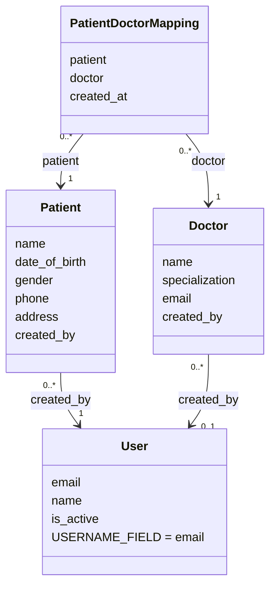
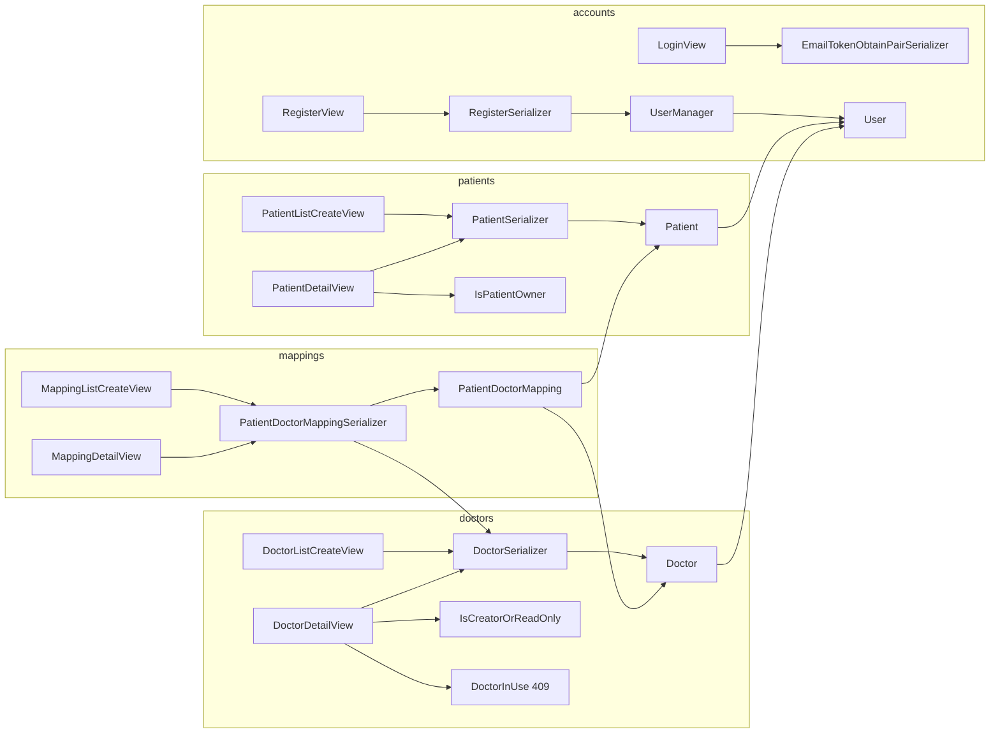

# Class Reference

The assignment names no classes; everything here is our design. Every class listed here exists in the code and is covered by tests, and this file is updated whenever the code changes.

**Related:** [design.md](design.md) (fields and contracts) · [architecture.md](architecture.md) (how requests flow)

---

## 1. Map of the models

Arrows point from the model that holds the foreign key to the model it references.

## 2. Who uses whom

---

## 3. accounts

> Tested by `accounts/tests.py` (49 tests, run on PostgreSQL).

### `User`

| | |
|---|---|
| **File** | `accounts/models.py` |
| **Inherits** | `django.contrib.auth.models.AbstractUser` |
| **Responsibility** | The person using the API. Logs in with an email address. |
| **Key attributes** | `email` (unique), `name`, `password` (hash), `is_active`, `is_staff`, `is_superuser`, `date_joined`; `username = None`, `first_name = None`, `last_name = None`; `USERNAME_FIELD = "email"`; `REQUIRED_FIELDS = ["name"]`; `objects = UserManager()`; `Meta(AbstractUser.Meta)` with `ordering = ["id"]` |
| **Key methods** | Inherited `set_password()` and `check_password()`; `__str__()` returns the email; `get_full_name()` and `get_short_name()` return `name` |
| **Depends on** | `UserManager` |
| **Used by** | `RegisterSerializer`; SimpleJWT (login, and turning a token back into a user); `Patient.created_by`; `Doctor.created_by`; `createsuperuser` |
| **Concepts** | Custom user model, `AUTH_USER_MODEL`, abstract base classes, model fields |

### `UserManager`

| | |
|---|---|
| **File** | `accounts/managers.py` |
| **Inherits** | `django.contrib.auth.base_user.BaseUserManager` |
| **Responsibility** | The only way users are created. Normalises the email and hashes the password. |
| **Key methods** | `normalize_email()`: trims and lower-cases the whole address (Django's own only lower-cases the domain); `get_by_natural_key()`: normalises before looking up, so Django's login check, admin login and `createsuperuser` match the stored email; `create_user(email, password, **extra_fields)`: requires an email and a non-blank `name`; `create_superuser(email, password, **extra_fields)`, which forces `is_staff` and `is_superuser` to True and rejects anything else |
| **Used by** | `RegisterSerializer.create()`, `python manage.py createsuperuser`, tests |
| **Uses** | `User` (via `self.model`), `set_password()` |
| **Concepts** | Model managers, `use_in_migrations` |

### `RegisterSerializer`

| | |
|---|---|
| **File** | `accounts/serializers.py` |
| **Inherits** | `rest_framework.serializers.ModelSerializer` |
| **Responsibility** | Validates registration input and creates the user |
| **Fields** | `id` (read-only), `name`, `email` (with `UniqueValidator(lookup="iexact")`), `password` (write-only) |
| **Key methods** | `validate_email()` trims and lower-cases (via `User.objects.normalize_email()`); `validate()` runs `validate_password()` against a temporary `User(email=..., name=...)`; `create()` calls `User.objects.create_user(...)` inside `transaction.atomic()` and turns an `IntegrityError` into a 400 on `email` |
| **Used by** | `RegisterView` |
| **Uses** | `User`, `UserManager`, Django's password validators |
| **Concepts** | `ModelSerializer`, field-level vs object-level validation, `write_only` |

### `EmailTokenObtainPairSerializer`

| | |
|---|---|
| **File** | `accounts/serializers.py` |
| **Inherits** | `rest_framework_simplejwt.serializers.TokenObtainPairSerializer` |
| **Responsibility** | Lower-cases the email before SimpleJWT checks the credentials |
| **Fields (inherited)** | `email`, `password` (write-only); the field name comes from `USERNAME_FIELD` |
| **Key methods** | `validate(attrs)`: normalises `attrs["email"]` with `User.objects.normalize_email()`, then calls `super().validate(attrs)`, which returns `{"refresh": ..., "access": ...}` |
| **Used by** | `LoginView` |
| **Uses** | Django's `authenticate()`, which uses `ModelBackend` and `User` |
| **Concepts** | Extending a library class instead of rewriting it |

### `RegisterView`

| | |
|---|---|
| **File** | `accounts/views.py` |
| **Inherits** | `rest_framework.generics.CreateAPIView` |
| **Key attributes** | `serializer_class = RegisterSerializer`; `permission_classes = [AllowAny]`; `authentication_classes = []`, so a stale `Authorization` header can't turn a registration into a 401 (as in SimpleJWT's own token views) |
| **Key methods** | Inherited `post()`, which calls `create()` and returns 201 |
| **URL** | `api/auth/register/` (name `auth-register`) |
| **Concepts** | Generic views; overriding the global permission default |

### `LoginView`

| | |
|---|---|
| **File** | `accounts/views.py` |
| **Inherits** | `rest_framework_simplejwt.views.TokenObtainPairView` |
| **Key attributes** | `serializer_class = EmailTokenObtainPairSerializer` |
| **URL** | `api/auth/login/` (name `auth-login`) |
| **Note** | SimpleJWT's token views set empty `authentication_classes` and `permission_classes`, so they are public even with our global default |

### `TokenRefreshView` (from SimpleJWT, used unchanged)

URL `api/auth/token/refresh/` (name `auth-token-refresh`), an extra endpoint beyond the assignment's. It takes `{"refresh": ...}` and returns `{"access": ...}`.

---

## 4. patients

> Tested by `patients/tests.py` (26 tests, run on PostgreSQL).

### `Patient`

| | |
|---|---|
| **File** | `patients/models.py` |
| **Inherits** | `django.db.models.Model` |
| **Responsibility** | A patient record that always knows which user created it |
| **Key attributes** | `created_by` (FK to `User`, `CASCADE`, `related_name="patients"`), `name`, `date_of_birth`, `gender` (choices from `Patient.Gender`), `phone` (with a `RegexValidator`), `address`, `created_at`, `updated_at`; `Meta.ordering = ["id"]` |
| **Nested class** | `Gender(models.TextChoices)`: `MALE`, `FEMALE`, `OTHER` |
| **Key methods** | `__str__()` returns the name |
| **Used by** | `PatientSerializer`, the patient views, `PatientDoctorMapping.patient` |
| **Concepts** | `ForeignKey`, `on_delete`, `choices`, validators, `auto_now` / `auto_now_add` |

### `PatientSerializer`

| | |
|---|---|
| **File** | `patients/serializers.py` |
| **Inherits** | `ModelSerializer` |
| **Fields** | `id`, `name`, `date_of_birth`, `gender`, `phone`, `address`, `created_at`, `updated_at`; `id` and the timestamps are read-only. `created_by` is deliberately **not** a field. |
| **Key methods** | `validate_date_of_birth(value)` rejects future dates |
| **Used by** | `PatientListCreateView`, `PatientDetailView` |

### `IsPatientOwner`

| | |
|---|---|
| **File** | `patients/permissions.py` |
| **Inherits** | `rest_framework.permissions.BasePermission` |
| **Key methods** | `has_object_permission(request, view, obj)` returns `obj.created_by_id == request.user.id` |
| **Used by** | `PatientDetailView`, together with `IsAuthenticated` |
| **Tested by** | A direct unit test. Through the API it can't be triggered, because the queryset already hides other users' patients. |

### `PatientListCreateView`

| | |
|---|---|
| **File** | `patients/views.py` |
| **Inherits** | `rest_framework.generics.ListCreateAPIView` |
| **Key methods** | `get_queryset()` returns `Patient.objects.filter(created_by=self.request.user)`; `perform_create(serializer)` calls `serializer.save(created_by=self.request.user)` |
| **URL** | `api/patients/` (name `patient-list`) |

### `PatientDetailView`

| | |
|---|---|
| **File** | `patients/views.py` |
| **Inherits** | `rest_framework.generics.RetrieveUpdateDestroyAPIView` |
| **Key attributes** | `permission_classes = [IsAuthenticated, IsPatientOwner]`; `http_method_names = ["get", "put", "delete", "head", "options"]` |
| **Key methods** | The same scoped `get_queryset()` as the list view |
| **URL** | `api/patients/<int:pk>/` (name `patient-detail`) |

---

## 5. doctors

> Tested by `doctors/tests.py` (21 tests, run on PostgreSQL).

### `Doctor`

| | |
|---|---|
| **File** | `doctors/models.py` |
| **Key attributes** | `created_by` (FK to `User`, `SET_NULL`, `null=True`, `related_name="doctors"`), `name`, `specialization`, `email` (unique), `created_at`, `updated_at`; `Meta.ordering = ["id"]` |
| **Key methods** | `__str__()` returns the name |
| **Used by** | `DoctorSerializer`, the doctor views, `PatientDoctorMapping.doctor` |

### `DoctorSerializer`

| | |
|---|---|
| **File** | `doctors/serializers.py` |
| **Fields** | `id`, `name`, `specialization`, `email`, `created_at`, `updated_at`; `created_by` is not a field |
| **Key methods** | `validate_email()` trims and lower-cases (via `User.objects.normalize_email()`); the email field uses `UniqueValidator(lookup="iexact")`; `save()` runs inside `transaction.atomic()` and turns an `IntegrityError` from a simultaneous duplicate into the same 400 on `email` |
| **Used by** | The doctor views; nested inside `PatientDoctorMappingSerializer` as `doctor_detail` |

### `IsCreatorOrReadOnly`

| | |
|---|---|
| **File** | `doctors/permissions.py` |
| **Key methods** | `has_object_permission()` returns True for safe methods (GET, HEAD, OPTIONS); otherwise `obj.created_by_id == request.user.id`. A NULL creator never matches, so the result is 403. |
| **Used by** | `DoctorDetailView` |

### `DoctorListCreateView`

| | |
|---|---|
| **File** | `doctors/views.py` |
| **Inherits** | `ListCreateAPIView` |
| **Key attributes and methods** | `queryset = Doctor.objects.all()`; `perform_create()` sets `created_by` |
| **URL** | `api/doctors/` (name `doctor-list`) |

### `DoctorDetailView`

| | |
|---|---|
| **File** | `doctors/views.py` |
| **Inherits** | `RetrieveUpdateDestroyAPIView` |
| **Key attributes** | `permission_classes = [IsAuthenticated, IsCreatorOrReadOnly]`; `http_method_names` restricted like the patient detail view |
| **Key methods** | `perform_destroy(instance)`: deletes, but catches `ProtectedError` (from the mapping's `PROTECT`) and raises `DoctorInUse` (409); nothing is deleted |
| **URL** | `api/doctors/<int:pk>/` (name `doctor-detail`) |

### `DoctorInUse`

| | |
|---|---|
| **File** | `doctors/views.py` |
| **Inherits** | `rest_framework.exceptions.APIException` |
| **Key attributes** | `status_code = 409`; `default_detail = "This doctor is assigned to one or more patients. Remove those assignments before deleting the doctor."`; `default_code = "doctor_in_use"` |

---

## 6. mappings

> Tested by `mappings/tests.py` (22 tests, run on PostgreSQL).

### `PatientDoctorMapping`

| | |
|---|---|
| **File** | `mappings/models.py` |
| **Key attributes** | `patient` (FK, `CASCADE`, `related_name="doctor_mappings"`), `doctor` (FK, `PROTECT`, `related_name="patient_mappings"`), `created_at` |
| **Meta** | `constraints = [UniqueConstraint(fields=["patient", "doctor"], name="unique_patient_doctor")]`; `ordering = ["id"]` |
| **Key methods** | `__str__()` returns "patient → doctor" |

### `PatientDoctorMappingSerializer`

| | |
|---|---|
| **File** | `mappings/serializers.py` |
| **Inherits** | `ModelSerializer` |
| **Fields** | `id`, `patient` (writable id), `patient_name` (read-only, from `patient.name`), `doctor` (writable id), `doctor_detail` (read-only `DoctorSerializer(source="doctor")`), `created_at` |
| **Key methods** | `get_fields()` limits the `patient` field's queryset to `Patient.objects.filter(created_by=request.user)`, using `self.context["request"]` |
| **Meta.validators** | `UniqueTogetherValidator(queryset=PatientDoctorMapping.objects.all(), fields=["patient", "doctor"], message="This doctor is already assigned to this patient.")` |
| **Used by** | Both mapping views |

### `MappingListCreateView`

| | |
|---|---|
| **File** | `mappings/views.py` |
| **Inherits** | `ListCreateAPIView` |
| **Key methods** | `get_queryset()` returns `PatientDoctorMapping.objects.filter(patient__created_by=user).select_related("patient", "doctor")`; `perform_create()` saves inside `transaction.atomic()` and turns an `IntegrityError` into the duplicate 400 |
| **URL** | `api/mappings/` (name `mapping-list`) |

### `MappingDetailView`

| | |
|---|---|
| **File** | `mappings/views.py` |
| **Inherits** | `rest_framework.views.APIView` |
| **Key methods** | `get(request, pk)`: **`pk` is a patient id**. Finds the patient with `get_object_or_404(Patient, pk=pk, created_by=request.user)` and returns that patient's mappings (200). `delete(request, pk)`: **`pk` is a mapping id**. Finds it with `get_object_or_404(PatientDoctorMapping, pk=pk, patient__created_by=request.user)`, deletes it, returns 204. |
| **URL** | `api/mappings/<int:pk>/` (name `mapping-detail`) |

---

## 7. Project configuration and URL modules (not classes)

### `config/settings.py` helpers

Covered by `SettingsHelperTests` in `config/tests.py`; each failure case was also checked by hand when the helpers were written.

| Function | What it does | Used for |
|---|---|---|
| `env_required(name)` | Returns the variable; raises `ImproperlyConfigured`, naming it, if it is missing or blank | `DJANGO_SECRET_KEY`, `DB_NAME`, `DB_USER`, `DB_PASSWORD` |
| `env_bool(name, default)` | Accepts true/false, 1/0, yes/no or on/off. An empty value gives the default; anything else raises `ImproperlyConfigured` | `DJANGO_DEBUG` (default `False`) |
| `env_list(name, default)` | Splits a comma-separated value into a list, dropping blanks | `DJANGO_ALLOWED_HOSTS` |

### URL modules

| Module | Patterns |
|---|---|
| `config/urls.py` | `admin/`; `api/auth/` → `accounts.urls`; `api/patients/` → `patients.urls`; `api/doctors/` → `doctors.urls`; `api/mappings/` → `mappings.urls`. Also `handler400`, `handler404` and `handler500` → `config/views.py` |
| `accounts/urls.py` | `register/`, `login/`, `token/refresh/` |
| `patients/urls.py` | `""` (list/create), `<int:pk>/` (detail) |
| `doctors/urls.py` | `""` (list/create), `<int:pk>/` (detail) |
| `mappings/urls.py` | `""` (list/create), `<int:pk>/` (GET by patient id, DELETE by mapping id) |

### `config/views.py` error handlers

Functions, not classes. Django calls them only when `DEBUG` is off; errors inside DRF views are already answered by DRF.

| Function | Answers | Body |
|---|---|---|
| `bad_request(request, exception)` | a request Django rejects, such as a body over `DATA_UPLOAD_MAX_MEMORY_SIZE` | 400 `{"detail": "Request body is too large."}` or `{"detail": "Bad request."}` |
| `not_found(request, exception)` | a URL that matches no route | 404 `{"detail": "Not found."}` |
| `server_error(request)` | an unexpected exception; the traceback goes to the server log (`LOGGING`) | 500 `{"detail": "A server error occurred."}` |

## 8. Library classes we rely on (not ours)

| Class | From | What we use it for |
|---|---|---|
| `AbstractUser`, `BaseUserManager` | `django.contrib.auth` | Base for `User` and `UserManager` |
| `ModelSerializer`, `UniqueValidator`, `UniqueTogetherValidator` | DRF | Serializers and their uniqueness checks |
| `CreateAPIView`, `ListCreateAPIView`, `RetrieveUpdateDestroyAPIView`, `APIView` | DRF | Views |
| `BasePermission`, `IsAuthenticated`, `AllowAny` | DRF | Permissions |
| `APIException` | DRF | Base for `DoctorInUse` |
| `JWTAuthentication` | SimpleJWT | Reads and verifies the Bearer token on every request |
| `TokenObtainPairSerializer`, `TokenObtainPairView`, `TokenRefreshView` | SimpleJWT | Login and token refresh |
| `APITestCase`, `APIClient` | DRF | Tests |

## 9. Test classes

| Class | File | Covers |
|---|---|---|
| No database: `UserModelDefinitionTests`, `UserManagerUnitTests`, `PasswordPolicyTests`, `RegisterEndpointWithoutDatabaseTests`, `TokenWithoutDatabaseTests`. PostgreSQL: `UserManagerTests`, `RegisterTests`, `LoginTests`, `RealJwtFlowTests`, `TokenRefreshTests` | `accounts/tests.py` | User model and manager, password policy, registration, login, refresh, real-JWT flow, `createsuperuser` |
| `PatientRequiresTokenTests`, `PatientRealJwtTests`, `PatientCreateTests`, `PatientReadUpdateDeleteTests`, `PatientIsolationTests`, `IsPatientOwnerTests` | `patients/tests.py` | CRUD and validation; no token → 401; real JWT; two-user isolation; `IsPatientOwner` unit test |
| `DoctorRequiresTokenTests`, `DoctorRealJwtTests`, `DoctorCreateTests`, `DoctorReadTests`, `DoctorPermissionTests`, `DoctorInUseTests`, `IsCreatorOrReadOnlyTests` | `doctors/tests.py` | CRUD and validation; no token → 401; real JWT; creator-only writes; duplicate race; 409 while assigned |
| `MappingRequiresTokenTests`, `MappingRealJwtTests`, `MappingCreateTests`, `MappingListTests`, `MappingByPatientTests`, `MappingDeleteTests`, `MappingCascadeTests` | `mappings/tests.py` | Assign, list (one query), by patient, delete; duplicates and the duplicate race; two-user isolation; patient id vs mapping id; patient delete cascades |
| `ErrorResponseTests`, `TokenLifecycleTests`, `ServerErrorTests`, `ResponseExposureTests`, `SettingsHelperTests` | `config/tests.py` | Project-wide: malformed JSON, 415, every 405, JSON 404, missing slash, oversized body; expired and deactivated tokens over HTTP; generic 500 plus the logged traceback; no password data or owner ids in responses; the settings helpers |

Each app also has at least one test that logs in through `/api/auth/login/` and uses the real token.
