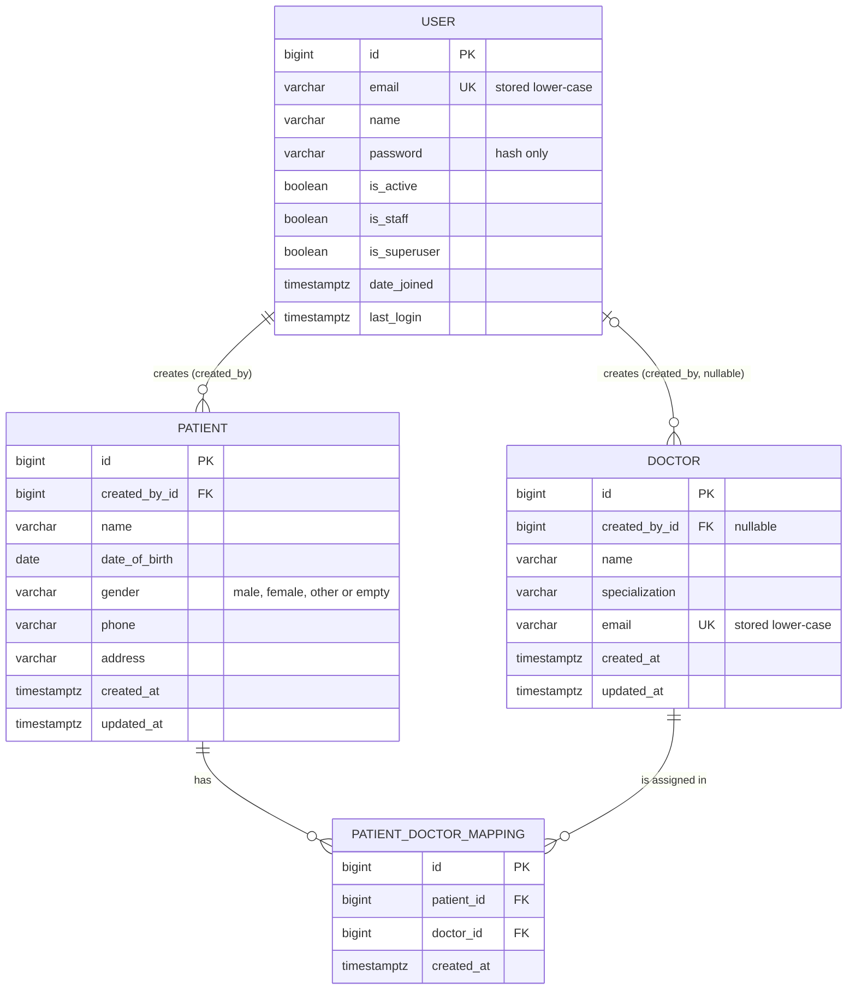

# Data and API Design

**Status:** Approved 27 Oct 2026. Implemented 28 Oct 2026. Update this file whenever the code changes, so it always describes the real system.
**Related:** [architecture.md](architecture.md) (how it fits together) · [class.md](class.md) (classes) · [api.md](api.md) (reference for API clients)

**Assignment requirement or our design?** The assignment fixes the stack and, for each endpoint, only the method, the path and a one-line purpose. Everything else in this document is our design, approved on 27 Oct 2026: fields, constraints, deletion rules, request and response bodies, status codes and error messages. Tags and "Source" columns show which is which: **[Spec]** comes from the assignment; **[Proposed]** is our decision.

---

## 1. Entity relationships



In short:

- A **user** creates many **patients**. Each patient has exactly one creator, who is its owner.
- A user can add many **doctors**. If that user is ever deleted, the doctor stays and its `created_by` becomes empty (NULL).
- Patients and doctors are many-to-many through **PatientDoctorMapping**. Each patient–doctor pair can appear at most once.

## 2. Field definitions

### 2.1 User — `accounts.User` (table `accounts_user`)

| Field | Django type | Required | Constraints and validation | Notes |
|---|---|---|---|---|
| `id` | BigAutoField | auto | primary key | |
| `email` | EmailField(254) | yes | unique; trimmed and stored lower-case; valid email format | the login identifier (`USERNAME_FIELD`) |
| `name` | CharField(150) | yes | not blank after trimming | full name as typed, not split into first and last |
| `password` | CharField(128) | yes | must pass Django's password validators | stores the hash (`pbkdf2_sha256$...`), never the password |
| `is_active` | BooleanField | default True | | inactive users can't log in |
| `is_staff`, `is_superuser` | BooleanField | default False | | only matter for Django admin |
| `date_joined`, `last_login` | DateTimeField | auto | | inherited from `AbstractUser` |

Removed from `AbstractUser`: `username`, `first_name`, `last_name`.

Default ordering: `id` ascending (`class Meta(AbstractUser.Meta)` with `ordering = ["id"]`, which keeps `AbstractUser`'s verbose names).

Source: the assignment names `name`, `email` and `password` for registration [Spec]. The model itself, email login and case-insensitive uniqueness are our design [Proposed].

### 2.2 Patient — `patients.Patient`

| Field | Django type | Required | Constraints and validation | Source |
|---|---|---|---|---|
| `id` | BigAutoField | auto | primary key | — |
| `created_by` | ForeignKey(User, on_delete=CASCADE, related_name="patients") | set by server | indexed; never accepted from the client; not returned | [Spec] "patients created by the authenticated user" |
| `name` | CharField(150) | yes | not blank after trimming | [Proposed] |
| `date_of_birth` | DateField | yes | format `YYYY-MM-DD`; not later than today | [Proposed] |
| `gender` | CharField(10, choices) | no | `male`, `female`, `other`, or empty | [Proposed] |
| `phone` | CharField(16) | no | regex `^\+?[0-9]{7,15}$` (7–15 digits, optional leading +) | [Proposed] |
| `address` | CharField(255) | no | at most 255 characters | [Proposed] |
| `created_at` | DateTimeField(auto_now_add) | auto | read-only | [Proposed] |
| `updated_at` | DateTimeField(auto_now) | auto | read-only | [Proposed] |

Default ordering: `id` ascending.

### 2.3 Doctor — `doctors.Doctor`

| Field | Django type | Required | Constraints and validation | Source |
|---|---|---|---|---|
| `id` | BigAutoField | auto | primary key | — |
| `created_by` | ForeignKey(User, on_delete=SET_NULL, null=True, related_name="doctors") | set by server | never accepted from the client; not returned | [Proposed] |
| `name` | CharField(150) | yes | not blank after trimming | [Proposed] |
| `specialization` | CharField(100) | yes | not blank after trimming; free text (e.g. "Cardiology") | [Proposed] |
| `email` | EmailField(254) | yes | unique across all doctors; trimmed and stored lower-case | [Proposed] |
| `created_at` | DateTimeField(auto_now_add) | auto | read-only | [Proposed] |
| `updated_at` | DateTimeField(auto_now) | auto | read-only | [Proposed] |

Default ordering: `id` ascending.

### 2.4 PatientDoctorMapping — `mappings.PatientDoctorMapping`

| Field | Django type | Required | Constraints and validation | Source |
|---|---|---|---|---|
| `id` | BigAutoField | auto | primary key; this is the id used by `DELETE /api/mappings/<id>/` | [Spec] |
| `patient` | ForeignKey(Patient, on_delete=CASCADE, related_name="doctor_mappings") | yes | must be one of the caller's patients | [Spec] + our design |
| `doctor` | ForeignKey(Doctor, on_delete=PROTECT, related_name="patient_mappings") | yes | must exist | [Spec] + our design |
| `created_at` | DateTimeField(auto_now_add) | auto | read-only | [Proposed] |

Meta: `UniqueConstraint(fields=["patient", "doctor"], name="unique_patient_doctor")`; ordering by `id`.

## 3. Validation rules and where they live

| Rule | Where it is enforced | Error response |
|---|---|---|
| Email format | serializer `EmailField` | 400 `{"email": ["Enter a valid email address."]}` |
| User email unique, ignoring case | `UniqueValidator(lookup="iexact")` on the serializer field, plus the DB unique index | 400 `{"email": ["A user with this email already exists."]}` |
| Password strength | `validate_password()` in `RegisterSerializer.validate()` | 400 `{"password": ["This password is too short. ..."]}` |
| Required fields present | serializer (derived from the model) | 400 `{"name": ["This field is required."]}` |
| Maximum lengths | serializer (derived from `max_length`) | 400 |
| Whitespace trimmed; blank after trimming rejected | DRF `CharField` defaults (`trim_whitespace=True`, `allow_blank=False`) | 400 `{"name": ["This field may not be blank."]}` |
| Date of birth not in the future | `PatientSerializer.validate_date_of_birth()` | 400 `{"date_of_birth": ["Date of birth cannot be in the future."]}` |
| Gender is an allowed value | model `choices` → serializer `ChoiceField` | 400 `{"gender": ["\"x\" is not a valid choice."]}` |
| Phone format | model `RegexValidator` | 400 `{"phone": ["Enter 7–15 digits, optionally starting with +."]}` |
| Doctor email unique, ignoring case | `UniqueValidator(lookup="iexact")` plus the DB unique index | 400 `{"email": ["A doctor with this email already exists."]}` |
| Mapping patient belongs to the caller | `patient` field's queryset limited to the caller's patients | 400 `{"patient": ["Invalid pk \"9\" - object does not exist."]}` |
| Mapping doctor exists | `doctor` field's queryset is all doctors | 400 `{"doctor": ["Invalid pk \"99\" - object does not exist."]}` |
| No duplicate mapping | `UniqueTogetherValidator` on the serializer, plus the DB constraint | 400 `{"non_field_errors": ["This doctor is already assigned to this patient."]}` |
| Server-controlled fields (`id`, `created_by`, timestamps) | read-only, or not on the serializer at all | silently ignored if sent |

**Ordering gotcha:** DRF runs a field's validators, including `UniqueValidator`, *before* the `validate_email()` method that lower-cases the value. A normal case-sensitive uniqueness check would therefore let `Asha@Example.com` through when `asha@example.com` exists, and the database would then reject the insert. That is why both unique validators use `lookup="iexact"`.

## 4. Uniqueness constraints

| Table | Constraint | Enforced by |
|---|---|---|
| `accounts_user` | `email` | DB unique index + serializer (`iexact`) |
| `doctors_doctor` | `email` | DB unique index + serializer (`iexact`) |
| `mappings_patientdoctormapping` | (`patient_id`, `doctor_id`) | DB constraint `unique_patient_doctor` + serializer |
| `patients_patient` | none: two patients may share a name and date of birth | — |

## 5. Ownership rules

| Object | Owner | Rule | Enforced in |
|---|---|---|---|
| Patient | `created_by` | Only the owner can see, change or delete it | view querysets (`created_by=request.user`) + `IsPatientOwner` |
| Doctor | `created_by` (may be NULL) | Every authenticated user can see it; only the creator can PUT or DELETE | `IsCreatorOrReadOnly` |
| Mapping | the owner of `mapping.patient` | Only that user can create, list, view or delete it | serializer `patient` queryset + view querysets (`patient__created_by=request.user`) |

## 6. Referential integrity and deletion behaviour

| When this is deleted | This happens | `on_delete` | Why |
|---|---|---|---|
| User | Their patients are deleted, and with them those patients' mappings | `Patient.created_by` CASCADE | patients are private to the user who created them |
| User | Doctors they added stay; `created_by` becomes NULL | `Doctor.created_by` SET_NULL | the shared directory shouldn't lose entries |
| Patient | Its mappings are deleted | `PatientDoctorMapping.patient` CASCADE | an assignment without a patient means nothing |
| Doctor | Refused with **409** if any mapping still references it | `PatientDoctorMapping.doctor` PROTECT | one user mustn't silently delete other users' assignments |
| Mapping | Only that row | — | |

There is no API endpoint for deleting users; that can only happen through Django admin or the shell.

---

## 7. API contracts

**What the assignment fixes, and what we designed.** For each endpoint the assignment gives only the method, the path and a one-line purpose; the headings below mark those **[Spec]**. Request bodies, response bodies, field names, status codes and error messages are **our design** (approved 27 Oct 2026). The approved contract is frozen: changing any part of it needs a new, documented design decision.

This section is the design record. For API clients, [api.md](api.md) presents the same contract endpoint by endpoint, with every field rule and error message.

Common rules for every endpoint:

- Local base URL: `http://127.0.0.1:8000`
- Bodies are JSON (`Content-Type: application/json`). Every URL ends with `/`.
- Protected endpoints need `Authorization: Bearer <access token>`. Without it → **401**.
- Timestamps are ISO 8601 in UTC (e.g. `2026-10-28T05:30:00.123456Z`). Dates are `YYYY-MM-DD`.
- Values in the examples are illustrative. The exact error texts are in section 8.

### 7.1 Authentication

#### `POST /api/auth/register/` — public · [Spec]

Request:

```json
{ "name": "Asha Verma", "email": "Asha.Verma@example.com", "password": "Clinic-Pass-2026" }
```

`201 Created`:

```json
{ "id": 1, "name": "Asha Verma", "email": "asha.verma@example.com" }
```

Errors: **400** for a missing or blank field, invalid email, an email that's already registered (any letter case), or a weak password. **405** for any method other than POST.

#### `POST /api/auth/login/` — public · [Spec]

Request:

```json
{ "email": "asha.verma@example.com", "password": "Clinic-Pass-2026" }
```

`200 OK`:

```json
{ "refresh": "eyJhbGciOiJIUzI1NiIsInR5cCI6...", "access": "eyJhbGciOiJIUzI1NiIsInR5cCI6..." }
```

Errors: **400** for a missing field. **401** for a wrong password, unknown email or inactive account, with `{"detail": "No active account found with the given credentials"}`. The response is the same in all three cases, so it doesn't reveal which emails are registered.

#### `POST /api/auth/token/refresh/` — public · [Proposed]

Request: `{ "refresh": "eyJhbGciOi..." }`

`200 OK`: `{ "access": "eyJhbGciOi..." }`

Errors: **400** for a missing field. **401** with `"code": "token_not_valid"` for an expired, tampered or wrong-type token (e.g. an access token sent here).

### 7.2 Patients — JWT required

#### `POST /api/patients/` · [Spec]

Request:

```json
{
  "name": "Rahul Mehta",
  "date_of_birth": "1990-04-12",
  "gender": "male",
  "phone": "+919876543210",
  "address": "12 MG Road, Pune"
}
```

`201 Created`:

```json
{
  "id": 7,
  "name": "Rahul Mehta",
  "date_of_birth": "1990-04-12",
  "gender": "male",
  "phone": "+919876543210",
  "address": "12 MG Road, Pune",
  "created_at": "2026-10-28T05:30:00.123456Z",
  "updated_at": "2026-10-28T05:30:00.123456Z"
}
```

`created_by` is taken from the token's user. It isn't returned, because it is always the caller. Errors: **400** validation, **401**.

#### `GET /api/patients/` · [Spec]

`200 OK`: a list of patient objects (shape as above), **only the caller's**, ordered by `id`. Returns `[]` if the caller has none.

#### `GET /api/patients/<id>/` · [Spec]

`200 OK`: one patient object. **404** if it doesn't exist *or belongs to another user*; both cases look identical.

#### `PUT /api/patients/<id>/` · [Spec]

Body like POST. `name` and `date_of_birth` are required. Optional fields that are left out keep their current values (that is how DRF's PUT works). `200 OK` with the updated object. Errors: **400**, **404** (as above).

#### `DELETE /api/patients/<id>/` · [Spec]

`204 No Content`; the patient's mappings are deleted too. **404** as above.

`PATCH` on a patient → **405**.

### 7.3 Doctors — JWT required

#### `POST /api/doctors/` · [Spec]

Request:

```json
{ "name": "Dr. Neha Kapoor", "specialization": "Cardiology", "email": "Neha.Kapoor@citycare.example" }
```

`201 Created`:

```json
{
  "id": 3,
  "name": "Dr. Neha Kapoor",
  "specialization": "Cardiology",
  "email": "neha.kapoor@citycare.example",
  "created_at": "2026-10-28T05:35:00.123456Z",
  "updated_at": "2026-10-28T05:35:00.123456Z"
}
```

Errors: **400** (including `{"email": ["A doctor with this email already exists."]}`), **401**.

#### `GET /api/doctors/` · [Spec]

`200 OK`: a list of **all** doctors, whoever added them, ordered by `id`.

#### `GET /api/doctors/<id>/` · [Spec]

`200 OK`: one doctor. **404** if it doesn't exist.

#### `PUT /api/doctors/<id>/` · [Spec]

`200 OK` with the updated doctor. Errors: **400**; **403** if the caller didn't add this doctor; **404**.

#### `DELETE /api/doctors/<id>/` · [Spec]

`204 No Content`. Errors: **403** if the caller didn't add this doctor; **404**; **409** while the doctor is still assigned:

```json
{ "detail": "This doctor is assigned to one or more patients. Remove those assignments before deleting the doctor." }
```

`PATCH` on a doctor → **405**.

### 7.4 Patient–doctor mappings — JWT required

> [!IMPORTANT]
> **The number in `/api/mappings/<id>/` means different things for GET and DELETE.** The assignment defines both routes this way, and we keep its URL contract unchanged:
>
> | Request | The number is a… | Meaning |
> |---|---|---|
> | `GET /api/mappings/7/` | **patient id** | list the doctors assigned to patient 7 |
> | `DELETE /api/mappings/7/` | **mapping id** | remove assignment 7 |
>
> To delete an assignment, use the mapping `id` from a mapping object, never the patient's id.

Every mapping response uses this **mapping object**. Its shape is **our design, not an assignment requirement** [Proposed]; the assignment only states what each endpoint is for.

```json
{
  "id": 12,
  "patient": 7,
  "patient_name": "Rahul Mehta",
  "doctor": 3,
  "doctor_detail": {
    "id": 3,
    "name": "Dr. Neha Kapoor",
    "specialization": "Cardiology",
    "email": "neha.kapoor@citycare.example",
    "created_at": "2026-10-28T05:35:00.123456Z",
    "updated_at": "2026-10-28T05:35:00.123456Z"
  },
  "created_at": "2026-10-28T05:40:00.123456Z"
}
```

#### `POST /api/mappings/` · [Spec]

Request: `{ "patient": 7, "doctor": 3 }`

`201 Created`: a mapping object.

Errors, all **400**:

- a missing field;
- a patient that doesn't exist or isn't the caller's (identical message for both: `Invalid pk "7" - object does not exist.`);
- a doctor that doesn't exist;
- the pair already exists (`non_field_errors`).

Also **401**.

#### `GET /api/mappings/` · [Spec]

`200 OK`: a list of mapping objects for **the caller's patients only**, ordered by `id`.

#### `GET /api/mappings/<patient_id>/` · [Spec] — the number is a **patient id**

The assignment specifies only the purpose: "Get all doctors assigned to a specific patient" [Spec].

`200 OK`: a list of that patient's mapping objects [Proposed]. Each one includes the doctor's details and the mapping `id` needed to delete it. Returns `[]` if no doctors are assigned. **404** if the patient doesn't exist or isn't the caller's [Proposed].

#### `DELETE /api/mappings/<id>/` · [Spec] — the number is a **mapping id**

`204 No Content`. **404** if the mapping doesn't exist or its patient isn't the caller's.

Any other method on `/api/mappings/<id>/` → **405** [Proposed].

---

## 8. Error response conventions

Our design [Proposed]; the assignment asks only for proper error handling and status codes. The texts below are exact: they were checked against the running code on 28 Oct 2026, and every row has a passing test.

| Status | When | Exact body | Verified by |
|---|---|---|---|
| 400 Bad Request | validation failed, or a duplicate | `{"<field>": ["<message>"]}` or `{"non_field_errors": ["<message>"]}`, e.g. `{"email": ["A user with this email already exists."]}`, `{"non_field_errors": ["This doctor is already assigned to this patient."]}` | `RegisterTests`, `PatientCreateTests`, `DoctorCreateTests`, `MappingCreateTests` |
| 400 Bad Request | malformed JSON | `{"detail": "JSON parse error - <parser message>"}`, e.g. `... - Expecting property name enclosed in double quotes: line 1 column 18 (char 17)` | `ErrorResponseTests.test_malformed_json_is_400` |
| 400 Bad Request | a body over `DATA_UPLOAD_MAX_MEMORY_SIZE` (2.5 MB) | `{"detail": "Request body is too large."}` (JSON `handler400`) | `ErrorResponseTests.test_a_body_over_the_size_limit_is_rejected` |
| 401 Unauthorized | no token | `{"detail": "Authentication credentials were not provided."}` | `PatientRequiresTokenTests`, `DoctorRequiresTokenTests`, `MappingRequiresTokenTests` |
| 401 Unauthorized | a bad, expired or wrong-type Bearer token | `{"detail": "Given token not valid for any token type", "code": "token_not_valid", "messages": [...]}` | `PatientRealJwtTests`, `TokenLifecycleTests` |
| 401 Unauthorized | the token's user was deactivated or deleted after login | `{"detail": "User is inactive", "code": "user_inactive"}`; for a deleted user `{"detail": "User not found", "code": "user_not_found"}` | `TokenLifecycleTests` |
| 401 Unauthorized | a bad token sent to `/api/auth/token/refresh/` | `{"detail": "Token is invalid", "code": "token_not_valid"}`; the detail is `"Token is expired"` or `"Token has wrong type"` for those cases | `TokenRefreshTests`, `TokenWithoutDatabaseTests` |
| 401 Unauthorized | failed login: wrong password, unknown email or inactive account | `{"detail": "No active account found with the given credentials"}` | `LoginTests` |
| 403 Forbidden | changing or deleting another user's doctor | `{"detail": "You do not have permission to perform this action."}` | `DoctorPermissionTests` |
| 404 Not Found | the object is missing or not the caller's | `{"detail": "No <Model> matches the given query."}`, e.g. `No Patient matches the given query.` | `PatientIsolationTests`, `MappingByPatientTests`, `MappingDeleteTests` |
| 404 Not Found | a URL that matches no route, including a non-integer id | `{"detail": "Not found."}` (JSON `handler404`; with `DEBUG` on, Django's debug page instead) | `ErrorResponseTests.test_unmatched_urls_get_a_json_404` |
| 405 Method Not Allowed | a method outside the contract (e.g. PATCH) | `{"detail": "Method \"PATCH\" not allowed."}` | `ErrorResponseTests.test_wrong_methods_are_405` |
| 409 Conflict | deleting a doctor who is still assigned | `{"detail": "This doctor is assigned to one or more patients. Remove those assignments before deleting the doctor."}` | `DoctorInUseTests` |
| 415 Unsupported Media Type | the body isn't JSON | `{"detail": "Unsupported media type \"application/x-www-form-urlencoded\" in request."}`, naming the request's content type | `ErrorResponseTests.test_non_json_bodies_are_415` |
| 500 Internal Server Error | an unexpected bug | `{"detail": "A server error occurred."}`; no stack trace for the client, while the traceback goes to the server log (JSON `handler500`, `LOGGING`) | `ServerErrorTests` |

No custom response envelope (like `{"success": ..., "data": ...}`) is used; responses follow DRF's standard shapes.

## 9. Edge cases (each one becomes a test)

The expected behaviours follow from the approved decisions above; the assignment doesn't spell out any of them. Every case below has an automated test.

| # | Case | Expected |
|---|---|---|
| E1 | Register `Asha@Example.com`, then `asha@example.com` | the second gets 400: email exists |
| E2 | Email with spaces around it | trimmed, then validated |
| E3 | Login with a different letter case in the email | 200 |
| E4 | Login as an inactive user | 401 |
| E5 | Password equal or very similar to the email or name | 400 |
| E6 | Token belonging to a user who was deactivated or deleted after login | 401 |
| E7 | Tampered token, or a refresh token sent as the Bearer token | 401 |
| E8 | Access token sent to the refresh endpoint | 401 |
| E9 | `/api/patients/abc/` | 404 (the URL pattern only accepts integers) |
| E10 | A huge id, e.g. `/api/patients/99999999999999999999/` | 404, not 500 |
| E11 | PUT that includes `created_by` or `id` in the body | ignored; the owner doesn't change |
| E12 | PUT without `name` | 400 |
| E13 | Date of birth tomorrow / today | 400 / 201 |
| E14 | Unknown extra fields in the body | ignored (DRF default) |
| E15 | Empty body `{}` on a POST | 400 listing the required fields |
| E16 | Malformed JSON | 400 |
| E17 | Form-encoded body | 415 |
| E18 | Missing trailing slash, e.g. `POST /api/patients` | not supported: Django raises an error while `DEBUG` is on, and redirects (dropping the body) when it is off. Always use the slash |
| E19 | Assigning the same doctor twice, even in two simultaneous requests | 400; exactly one row exists |
| E20 | Assigning a doctor to another user's patient | 400 "Invalid pk", identical to a non-existent patient |
| E21 | `GET /api/mappings/<id>/` called with a mapping id | treated as a patient id (documented behaviour) |
| E22 | Deleting a patient who has mappings | 204; the mappings are gone |
| E23 | Deleting a doctor who is assigned | 409; nothing is deleted |
| E24 | A doctor whose creator was deleted | visible to everyone; PUT and DELETE → 403 for everyone |
| E25 | Two users add the same doctor email in different letter case | the second gets 400 |
| E26 | Strings longer than `max_length` | 400 |
| E27 | A name made only of spaces | 400 |
| E28 | Expired access token, then a refresh | 401, then 200 with a new access token |
